<!-- N/Y · Editorial engineering portfolio · GitHub-compatible motion SVG -->
<div align="center">
  <a href="https://yarranishwanth.tech">
    
  </a>
  <br />
  <a href="https://yarranishwanth.tech">Portfolio ↗</a>
  &nbsp;&nbsp;·&nbsp;&nbsp;
  <a href="https://www.linkedin.com/in/yarranishwanth/">LinkedIn ↗</a>
  &nbsp;&nbsp;·&nbsp;&nbsp;
  <a href="mailto:nishwanthyarra@gmail.com">Email ↗</a>
  &nbsp;&nbsp;·&nbsp;&nbsp;
  <a href="https://github.com/Nishwanth2809?tab=repositories">Repositories ↗</a>
</div>

<br />

### 01 / THE ENGINEER

I build at the intersection of **artificial intelligence and product engineering** — translating research ideas into usable, reliable software. My work spans **machine learning, NLP, computer vision, APIs, and full-stack applications**.

I'm a final-year **B.Tech Computer Science (AI & ML)** student with hands-on experience building production-style web products and mentoring early-stage builders.

```text
CURRENT SIGNAL
├── BUILDING    CodeMentor · AI-powered developer learning
├── RESEARCH    Brahmi script recognition · Computer vision
├── EXPLORING   LLM systems · Retrieval · System design
└── APPROACH    Think clearly. Engineer carefully. Ship deliberately.
```

---

### 02 / SELECTED WORK

<table>
<tr><td width="50%" valign="top">

**01 — CodeMentor**  
<sub>AI-POWERED DEVELOPER PLATFORM · IN DEVELOPMENT</sub>

An intelligent coding mentor focused on context-aware assistance, personalized learning, and actionable code feedback.

**Focus:** LLM applications · Developer tooling · Retrieval · APIs

[Explore work ↗](https://yarranishwanth.tech)

</td><td width="50%" valign="top">

**02 — Brahmi Script Interpretation**  
<sub>COMPUTER VISION · DEEP LEARNING · IN DEVELOPMENT</sub>

Researching methods to recognize ancient Brahmi characters from images and make historical writing more accessible.

**Focus:** Image processing · Character recognition · Deep learning

[Explore work ↗](https://yarranishwanth.tech)

</td></tr>
<tr><td colspan="2" valign="top">

**03 — Twiller**  
<sub>FULL-STACK SOCIAL PLATFORM · ENGINEERING PROJECT</sub>

Built and tested features spanning REST APIs, Firebase authentication, Razorpay payments, and security-focused workflows, with Next.js, Express, and MongoDB.

[Live project ↗](https://twiller-ruby.vercel.app/) &nbsp;·&nbsp; [More projects ↗](https://github.com/Nishwanth2809?tab=repositories)

</td></tr>
</table>

---

### 03 / ENGINEERING TOOLKIT

Technologies central to my work, organized by what they help me build.

| Discipline | Tools and technologies |
| :--- | :--- |
| **AI & ML** | Python · PyTorch · TensorFlow · scikit-learn · Hugging Face · NumPy · Pandas |
| **LLM & Data Systems** | Gemini API · Qdrant · NLP · Computer Vision |
| **Frontend** | React · Next.js · JavaScript · Tailwind CSS |
| **Backend** | FastAPI · Flask · Node.js · Express · REST APIs |
| **Data & Infrastructure** | MongoDB · PostgreSQL · Firebase · Docker · Linux |
| **Workflow** | Git · GitHub · Postman · Vercel · Render · Figma |

---

### 04 / EXPERIENCE & IMPACT

**Full-Stack Web Development Intern** · ElevanceSkills  
<sub>APR 2026 — SEP 2026 · REMOTE</sub>

Developed Twiller, a social product integrating REST APIs, authentication, payments, and application testing. Worked across product surfaces and backend infrastructure.

**Student Mentor & Council Member** · Centre for Innovation & Entrepreneurship  
<sub>DEC 2025 — PRESENT · HYDERABAD</sub>

Mentored **100+ students**, from idea validation to deployable applications. Led technical learning on ML, APIs, Git, and software architecture.

---

### 05 / DEVELOPMENT ACTIVITY

<div align="center">
  
  <br />
  
  
</div>

<details>
<summary><b>View the contribution snake</b></summary>
<br />
<div align="center">
  <picture>
    <source media="(prefers-color-scheme: dark)" srcset="https://raw.githubusercontent.com/Nishwanth2809/Nishwanth2809/output/github-snake-dark.svg" />
    <source media="(prefers-color-scheme: light)" srcset="https://raw.githubusercontent.com/Nishwanth2809/Nishwanth2809/output/github-snake.svg" />
    
  </picture>
</div>
</details>

---

<div align="center">

### Have a technically ambitious idea?

I'm interested in collaborations where **intelligent systems meet thoughtful product design**.

[**Discuss a project ↗**](mailto:nishwanthyarra@gmail.com) &nbsp;·&nbsp; [**Explore my portfolio ↗**](https://yarranishwanth.tech)

<sub>DESIGNED WITH INTENT · BUILT TO LAST · NISHWANTH YARRA</sub>

</div>
