<!-- ═══════════════ HEADER ═══════════════ -->
<div align="center">


<a href="https://yarranishwanth.tech">
  
</a>

<br/>


<br/><br/>

<a href="https://yarranishwanth.tech"></a>
<a href="https://linkedin.com/in/yarranishwanth"></a>
<a href="mailto:nishwanthyarra@gmail.com"></a>
<a href="https://instagram.com/nishwanth_28"></a>

</div>

<br/>

<!-- ═══════════════ ABOUT ═══════════════ -->
## 👨‍💻 &nbsp;`whoami`

```python
class NishwanthYarra:
    role        = "AI & Machine Learning Engineer | Full-Stack Developer"
    education   = "B.Tech CSE (AI & ML) — Final Year"
    building    = ["CodeMentor", "AI-Based Brahmi Script Interpretation System"]
    learning    = ["LLMs", "Advanced NLP", "System Design", "Cloud & DevOps"]
    superpowers = ["Machine Learning", "NLP", "Computer Vision", "Full-Stack Web"]
    ask_me_about = ["Python", "Java", "FastAPI", "React", "ML", "Backend Development"]

    def mission(self):
        return "Build intelligent, scalable, user-centric software that solves real-world problems."
```

<br/>

<!-- ═══════════════ FEATURED PROJECTS ═══════════════ -->
## 🚀 &nbsp;Featured Projects

<table>
<tr>
<td width="50%" valign="top">

### ⚡ Twiller
**Full-Stack Social Platform**

A production-style social application developed with modern web technologies.

- 🔐 Firebase authentication
- 🔗 Scalable REST APIs
- 💳 Razorpay payment integration
- 🛡️ Security-focused application workflows


[**Live Project ↗**](https://twiller-ruby.vercel.app/)

</td>
<td width="50%" valign="top">

### 📜 Brahmi Script Interpreter
**Deep Learning × Computer Vision × Heritage**

An AI-based system exploring recognition and interpretation of ancient Brahmi script from images.

- 👁️ Character recognition from images
- 🧬 Deep learning-based classification
- 🏛️ Making historical text machine-readable


[**Project Details ↗**](https://yarranishwanth.tech)

</td>
</tr>
</table>

<br/>

<!-- ═══════════════ TECH STACK ═══════════════ -->
## 🛠️ &nbsp;Tech Stack

<table>
<tr>
<td width="50%" valign="top">

### 🤖 AI, ML & Data


</td>
<td width="50%" valign="top">

### ⚙️ Backend & APIs


</td>
</tr>
<tr>
<td width="50%" valign="top">

### 🎨 Frontend & Mobile


</td>
<td width="50%" valign="top">

### 🗄️ Databases & Cloud


</td>
</tr>
<tr>
<td width="50%" valign="top">

### 🧰 Developer Tools


</td>
<td width="50%" valign="top">

### ✨ Design & Payments


</td>
</tr>
</table>

<br/>

<!-- ═══════════════ LEARNING ROADMAP ═══════════════ -->
## 🌱 &nbsp;Growth Roadmap

```mermaid
%%{init: {'theme':'dark', 'themeVariables': {'primaryColor':'#0d1117','primaryBorderColor':'#00f7ff','lineColor':'#00f7ff','primaryTextColor':'#ffffff'}}}%%
flowchart LR
    A([🎓 Foundations<br/>Python • Java • DSA]) --> B([🧠 ML & Deep Learning<br/>PyTorch • TensorFlow])
    B --> C([💬 NLP & CV<br/>Transformers • Vision])
    C --> D([🤖 LLMs<br/>Apps • Vector Search])
    D --> E([🏗️ System Design<br/>Scale • Reliability])
    E --> F([☁️ Cloud & DevOps<br/>Docker • CI/CD])
    style D stroke:#39ff14,stroke-width:3px
    style E stroke:#39ff14,stroke-width:3px
    style F stroke:#39ff14,stroke-width:3px
```



> 🟢 Green nodes = what I'm actively learning right now.

<br/>

<!-- ═══════════════ STATS ═══════════════ -->
## 📊 &nbsp;GitHub Command Center

<div align="center">
  
  <br/>
  
  
</div>

<br/>

<!-- ═══════════════ SNAKE ═══════════════ -->
## 🐍 &nbsp;Contribution Snake

<div align="center">

<picture>
  <source media="(prefers-color-scheme: dark)" srcset="https://raw.githubusercontent.com/Nishwanth2809/Nishwanth2809/output/github-snake-dark.svg" />
  <source media="(prefers-color-scheme: light)" srcset="https://raw.githubusercontent.com/Nishwanth2809/Nishwanth2809/output/github-snake.svg" />
  
</picture>

</div>

<br/>

<!-- ═══════════════ CONTACT ═══════════════ -->
## 🤝 &nbsp;Let's Build Something Remarkable

<div align="center">

Got an idea in **AI**, **ML**, or **full-stack**? Want to collaborate, mentor, or just talk tech?

<a href="mailto:nishwanthyarra@gmail.com">
  
</a>

<br/>

<a href="https://yarranishwanth.tech"></a>

</div>

<br/>


<div align="center">
  <sub>⭐ If something here inspired you, drop a star — it fuels the next build.</sub>
</div>
